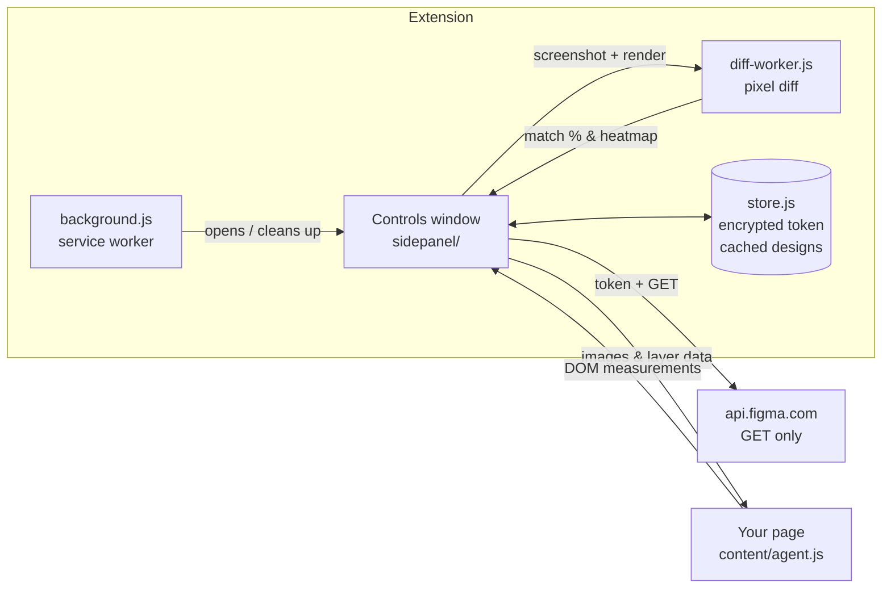

<div align="center">


# Figma Match — Design QA

**Pixel-perfect design QA, right in Chrome.**
Compare a live web page with its Figma desktop frame, find every difference, and get a fix list you can paste straight into a ticket.


</div>

---

## Table of contents

- [Why Figma Match?](#why-figma-match)
- [Features](#features)
- [Installation](#installation)
- [Quick start](#quick-start)
- [Detailed workflow](#detailed-workflow)
- [How it works](#how-it-works)
- [Project structure](#project-structure)
- [Permissions](#permissions)
- [Security](#security)
- [Tips for Web Lankan themes](#tips-for-web-lankan-themes)
- [Troubleshooting](#troubleshooting)
- [Contributing](#contributing)

---

## Why Figma Match?

Checking a build against a design by eye is slow and misses things: a 2px gap, a font weight of 500 instead of 600, a heading that wraps one word early. Figma Match puts the design and the page side by side, measures them, and tells you exactly what's off and where, so you can fix it in one pass.

## Features

| Tool | What it does |
|---|---|
| 🖼️ **Overlay** | Draws the Figma frame on top of the page. Switch between Normal and Difference blend, change the opacity, nudge it, or snap it to a section. |
| 🧩 **Sections** | Links each Figma section (Header, Hero, About…) to its element on the page, so each section is compared on its own. Auto-match does most of the work. |
| 🔍 **Pixel diff** | Takes a full-page screenshot and compares it with the Figma render. Gives a match % per section, the height difference, and a red heatmap on the page. |
| 📐 **Spec check** | Checks every Figma text layer against its element: font family, size, weight, line height, letter spacing, colour, text case, line wrapping, position and text content. |
| 📋 **Copy fix list** | Builds a Markdown report with selectors, Figma values and site values side by side, ready for a ticket or for Claude Code. |

Also included:

- **Floating on-page toolbar** (drag it by ⠿) for overlay on/off, design/heatmap, difference mode and opacity, so you rarely need the controls window.
- **Viewport lock** to force the page to exactly the frame width (for example 1920px), even on a smaller screen.
- **Freeze** to pause animations and smooth scrolling before a capture.
- **Per-page memory**: the linked Figma frame and section matches are saved for each page and reload automatically.

---

## Installation

Figma Match isn't on the Chrome Web Store. Load it in developer mode; there's no build step.

1. **Get the code**
   ```bash
   git clone https://github.com/Shani67/figma-match-extension.git
   ```
   or download the ZIP from GitHub and unzip it.
2. Open `chrome://extensions` and turn on **Developer mode** (top right).
3. Click **Load unpacked** and select the `figma-match-extension` folder.
4. Pin the extension and click its icon.

The controls open in their **own small window**, so the page tab keeps its full width (for example 1920px) and the comparison is 1:1. Put the controls window anywhere (a second monitor is ideal) or minimise it; it remembers its position.

> **Updating?** Pull the latest code, then click the reload icon on the extension in `chrome://extensions`.

**Requirements:** Chrome (or another Chromium browser) version 116 or newer, and a Figma account with access to the design file.

---

## Quick start

```text
1. Connect Figma    → paste a read-only personal access token
2. Allow the site   → click "Allow on <site>"
3. Load the frame   → paste a Figma "Copy link to selection" URL
4. Auto-match       → link Figma sections to page elements
5. Run the checks   → Overlay · Pixel diff · Spec check
6. Copy fix list    → paste into your ticket or editor
```

---

## Detailed workflow

### 1. Connect Figma (once)

1. In Figma, go to **Settings → Security → Personal access tokens → Generate new token**.
2. Choose only these scopes: **File content: Read-only** and **Current user: Read**. Set an expiry (for example 90 days).
3. Paste the token into the panel and click **Connect Figma**. Your Figma name and avatar appear at the top.

### 2. Check a page

1. **Open the page** (for example `http://suyamas.local/corporate-hospitality/`) and click **Allow on suyamas.local**.
2. **Load the frame.** In Figma, select the desktop frame → right-click → **Copy link to selection**. Paste the link into the panel and click **Load**. The frame is saved for this page, so next time it loads straight away.
3. **Check the test conditions.** The panel shows whether the page is really as wide as the frame, for example *"Page is 1920px wide · 1:1 with Figma"*.
   - Maximise the browser window and keep the zoom at 100% (<kbd>Ctrl</kbd>+<kbd>0</kbd>).
   - Leave **Hide page scrollbar** on. Otherwise the scrollbar takes about 15px and the page is only 1905px wide.
   - Turn on **Force exactly 1920px** only if your screen is narrower than the frame. The checks also do this for you when they need it.
4. **Match sections.** Click **Sections → Auto-match**. Check the links with **Show** and fix any wrong ones with **Pick** (<kbd>↑</kbd> selects the parent element).
5. **Overlay.** Compare by eye. Difference mode makes every shift stand out.
6. **Pixel diff.** See which sections are furthest off, and where.
7. **Spec check.** Get the exact values to fix. Click a row to highlight the element: the **green box** is the site and the **dashed orange box** is Figma.
8. **Fix and repeat.** Update your SCSS and reload the page. The overlay, viewport lock and freeze come back automatically; run the checks again.

---

## How it works



- The **controls window** is the only place that holds the Figma token and talks to the Figma API.
- The **page agent** is injected only into sites you have allowed. It draws the overlay, toolbar and heatmap, and measures elements, but never sees the token.
- The **diff worker** compares pixels off the main thread using the YIQ colour metric (the same idea as pixelmatch) with a 1px shift tolerance, so anti-aliasing and sub-pixel text don't flood the result.
- The **service worker** opens the controls window and, when it closes, detaches the debugger and removes the overlay.

---

## Project structure

```text
figma-match-extension/
├── manifest.json          # MV3 manifest: permissions, CSP, icons
├── background.js          # Service worker: opens controls window, cleanup
├── content/
│   └── agent.js           # Injected page script: overlay, toolbar, heatmap, DOM measurements
├── lib/
│   ├── figma.js           # Read-only Figma REST API client
│   ├── store.js           # AES-GCM token encryption + IndexedDB design cache
│   └── diff-worker.js     # Web Worker for the pixel diff
├── sidepanel/
│   ├── sidepanel.html     # Controls UI
│   ├── sidepanel.css
│   └── sidepanel.js       # UI logic, checks, fix list
└── icons/                 # 16 / 32 / 48 / 128 px icons
```

---

## Permissions

| Permission | Why it's needed |
|---|---|
| `storage`, `unlimitedStorage` | Save settings, the encrypted token and cached Figma renders (renders of tall frames can be large). |
| `scripting` | Inject the page agent into sites you have allowed. |
| `tabs` | Know which tab is being checked and its URL. |
| `debugger` | Full-page screenshots for the pixel diff, and the optional exact-width viewport lock. Attached only to the tab being checked, and only while needed. |
| `https://api.figma.com/*` | Read the design file and render frames. |
| `https://figma-alpha-api.s3.us-west-2.amazonaws.com/*` | Download the rendered frame images Figma returns. |
| `optional_host_permissions` (`http://*/*`, `https://*/*`) | **Not granted by default.** Asked for per site when you click "Allow on <site>". |

---

## Security

- **Read-only access.** The token only needs read scopes, and the extension only ever sends `GET` requests to `api.figma.com`.
- **Encrypted token.** It is stored encrypted with AES-256-GCM. The key is a non-exportable WebCrypto key in the extension's own IndexedDB, which web pages and content scripts can't reach.
- **Session-only option.** If you untick *Keep me signed in*, the encrypted token stays in `chrome.storage.session` (memory only) and is wiped when Chrome closes.
- **The token never reaches the page.** All Figma calls happen in the controls window. The script injected into the page only receives images and layer data.
- **Explicit site access.** The extension can't touch any website until you click *Allow on <site>* for it. It runs only on pages you have allowed.
- **Strict messaging.** The page script accepts messages only from this extension. The extension accepts nothing from other extensions or websites.
- **Limited debugger use.** The `debugger` permission is used only for pixel-diff screenshots (attached for those few seconds) and the optional width lock, and only on the tab you are checking. It is detached when the capture ends, when you unlock, or when you close the controls window.
- **No remote code and no tracking.** Extension pages use a strict Content-Security-Policy, and dynamic text is written with `textContent`, never `innerHTML`.
- **Sign out** deletes the token, the key and all cached designs. You can also revoke the token in Figma at any time.

<details>
<summary><b>Why a personal token instead of "Log in with Figma" (OAuth)?</b></summary>

Figma's OAuth flow needs a client secret. A secret shipped inside an extension can be read by anyone who installs it, so OAuth would only be safe with a separate backend server. A personal, read-only, expiring token is the safer choice for an internal tool.

</details>

---

## Tips for Web Lankan themes

- **Pin sections to Figma nodes.** Add `data-figma-node="12:345"` to each section's wrapper, only when `WP_DEBUG` is on. Auto-match then links that section correctly every time.
- **Expose Lenis in dev.** Lenis is created inside a closure in `assets/js/site.js`. Exposing it in development (`window.lenis = lenis;`) lets **Freeze** switch smooth scrolling off completely before captures.
- **Always lock the viewport.** Sizes written with `get-vw()` only equal the design at the design width, so lock the viewport before running checks.

---

## Troubleshooting

| Problem | Cause and fix |
|---|---|
| **"Could not lock the viewport"** | Another debugging extension (or DevTools protocol client) is attached to the tab. Close it and try again. |
| **Overlay image missing** | The site's Content-Security-Policy blocks `data:` images. Local sites are normally fine. |
| **Page width isn't 1920px** | Browser zoom isn't 100%, the window isn't maximised, or OS display scaling makes the window narrower. Use **Force exactly 1920px**. |
| **Very tall page cut off** | Captures are limited to 30,000px in height. |
| **Text never reaches 100% in the pixel diff** | Figma and Chrome render fonts slightly differently. Use the **Spec check** for typography. |

---

## Contributing

Issues and pull requests are welcome.

1. Fork the repository and create a branch: `git checkout -b feature/my-change`
2. Load your copy unpacked in `chrome://extensions` and test on a real page and Figma frame.
3. Keep to the security model above: no remote code, no `innerHTML` for dynamic text, Figma calls only from the controls window.
4. Open a pull request describing what changed and how you tested it.
